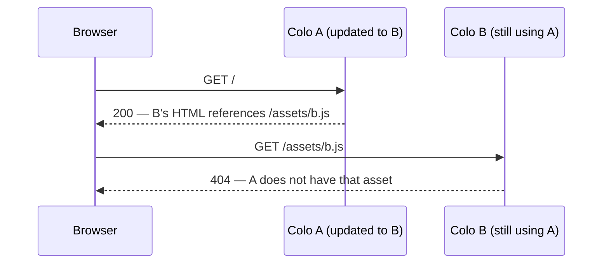
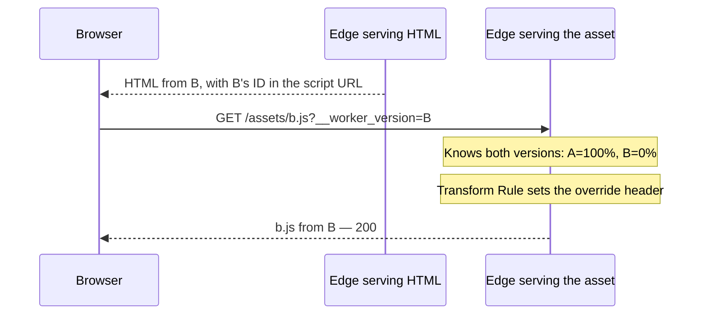
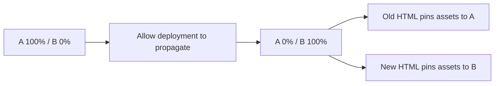

# Workers version skew repro

## The problem

Deploying a new Worker version updates the configuration that tells each edge
location which version to run. That update takes a few seconds to propagate
across Cloudflare's edge. During that window, different data centers (colos)
can route requests to different versions.

Suppose version A is live, and you publish version B. B's HTML references a new
asset, `/assets/b.js`, that does not exist in A's asset manifest:



The HTML request succeeds, but the next request can land at a colo whose
configuration still selects the previous version. Its asset manifest does not
contain the file the browser needs. This mismatch between HTML and assets is
**version skew**, and it can cause a brief 404 during deployment.

## What this repro shows

The HTML puts its Worker version ID in the asset URL. A Request Header Transform
Rule converts that query parameter into a version override header, so the asset
request selects the same version as the HTML.

This repro proves that an asset can be served from a version at **0% traffic**,
provided that version is included in the receiving colo's deployment configuration.

## The request

```text
/assets/b.js?__worker_version=<version-b-id>
```

A Request Header Transform Rule turns that into:

```http
Cloudflare-Workers-Version-Overrides: workers-skew-protection-repro="<version-b-id>"
```



The Worker embeds the ID of the version serving the HTML:

```ts
const version = env.CF_VERSION_METADATA.id;
// HTML emitted by release B:
// <script src="/assets/b.js?__worker_version=<version-b-id>"></script>
```

Each version has one asset. A has `/assets/a.js`; B has `/assets/b.js`.
The Worker serves its own native asset manifest through `env.ASSETS.fetch()`.

## Deploy two versions

Use Node.js 24.22.0 (or another version supported by `package.json`), a Cloudflare
account, and an **unused test hostname** on a proxied zone with working HTTPS.
Transform Rules require your own zone; this query-to-header rule does not run on
`workers.dev`.

```sh
npm ci

export CLOUDFLARE_ACCOUNT_ID='your-account-id'
export CLOUDFLARE_ZONE_ID='your-zone-id'
export REPRO_HOSTNAME='skew.example.com'

npx cf auth login
npm run typecheck
npx cf deploy --mode a --tag a
export VERSION_A='version-id-printed-by-deploy'

npx cf workers versions create --mode b --tag b
export VERSION_B='version-id-printed-by-upload'
```

## Add the Transform Rule

Generate the rule from those values:

```sh
mkdir -p work
node scripts/rule.mjs > work/rule.json
cat work/rule.json
```

The rule matches only your test hostname, the three repro paths, and the two
version IDs. Its dynamic header value is:

```text
concat("workers-skew-protection-repro=\"", http.request.uri.args["__worker_version"][0], "\"")
```

Find the zone's request-header ruleset:

```sh
npx cf rulesets entrypoint get http_request_late_transform \
  --zone "$CLOUDFLARE_ZONE_ID"
```

If it exists, append this rule using the returned ruleset ID:

```sh
export RULESET_ID='id-from-the-response'
npx cf rulesets rules create "$RULESET_ID" \
  --zone "$CLOUDFLARE_ZONE_ID" --body @work/rule.json
```

If the lookup reports **no entrypoint ruleset**, create one instead:

```sh
node scripts/rule.mjs --ruleset > work/ruleset.json
npx cf rulesets create --zone "$CLOUDFLARE_ZONE_ID" --body @work/ruleset.json
```

## Hold B at 0%

Include both versions in the deployment:

```sh
npx cf workers deployments create \
  --worker workers-skew-protection-repro --strategy percentage \
  --versions "[{\"version_id\":\"$VERSION_A\",\"percentage\":100},{\"version_id\":\"$VERSION_B\",\"percentage\":0}]"

sleep 10
npm run verify -- a
```

The verifier checks the actual serving version as well as the status code:

| Request | Result |
| --- | --- |
| `/` | 200 from A |
| `/?__worker_version=B` | 200 from B; HTML pins its script to B |
| `/assets/b.js` | 404 from A |
| `/assets/b.js?__worker_version=B` | 200 from B |

Try the two asset requests yourself:

```sh
curl -i "https://$REPRO_HOSTNAME/assets/b.js"
curl -i "https://$REPRO_HOSTNAME/assets/b.js?__worker_version=$VERSION_B"
```

Open `https://<your-test-hostname>/?__worker_version=<version-b-id>` in a browser.
It should show:

```text
HTML: release b
Asset: release b
```

## Promote B and keep A available

```sh
npx cf workers deployments create \
  --worker workers-skew-protection-repro --strategy percentage \
  --versions "[{\"version_id\":\"$VERSION_A\",\"percentage\":0},{\"version_id\":\"$VERSION_B\",\"percentage\":100}]"

sleep 10
npm run verify -- b
```

Now the same checks run against A: its pinned asset returns 200; its unpinned
asset returns 404 from B.



## Limits

- **Ten seconds is a buffer, not a global completion guarantee.** This repro
  tests an edge that knows both versions while one is at 0%. It does not force
  successive requests into different colos.
- Keep both versions in the deployment. An override for a version outside the
  current deployment falls back to normal routing.
- Two retained versions do not cover every old browser tab. Asset retention
  still matters for later releases.
- Real applications must carry the ID on every relevant asset request, including
  imported chunks and CSS URLs. A parent's query string is not inherited.
- Caching is disabled here so it cannot hide routing differences.

See Cloudflare's [version override documentation](https://developers.cloudflare.com/workers/versions-and-deployments/version-overrides/)
and [version metadata binding](https://developers.cloudflare.com/workers/runtime-apis/bindings/version-metadata/).
